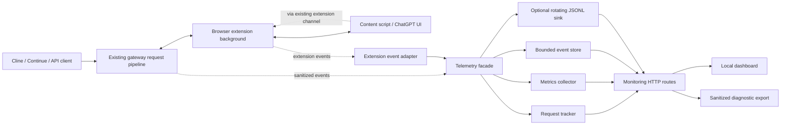

# ChatGPT Gateway Monitor — Architecture and Implementation Proposal

**Status:** Proposed implementation specification  
**Target repository:** [badiibayoudh/chatgpt-gateway](https://github.com/badiibayoudh/chatgpt-gateway/tree/fix/chatgpt-dom-compatibility)  
**Target branch:** `fix/chatgpt-dom-compatibility` (create a dedicated implementation branch from its current state)  
**Dashboard URL:** `http://localhost:18790/dashboard`  
**Intended audience:** AI coding agents and maintainers of ChatGPT Gateway

## 1. Objective

Implement a lightweight, local monitoring frontend for ChatGPT Gateway. It must make the gateway's behavior understandable, provide reliable evidence for troubleshooting, and allow the user to collect concise, sanitized diagnostic information without inspecting multiple terminal windows, browser developer consoles, and IDE histories.

The dashboard should help answer:

- Is the gateway running, and is the browser extension connected and ready?
- What request is being processed, what is waiting, and where is time being spent?
- Is conversation reuse working? Why are full histories or tool definitions resent?
- How much data enters the gateway versus how much is transmitted to the browser?
- When are text and image attachments attempted, uploaded, rejected, or skipped?
- Which Cline, Continue, or MCP tools are requested, validated, forwarded, and observed to return results?
- Why did a request fail, and what evidence can be exported to diagnose it?

The primary use case is a local Windows development environment using Cline, the customized gateway, Chrome/ChatGPT, Godot MCP, Mobile MCP, and Context7. The design must remain generic and should not depend on these particular MCP servers or an individual IDE.

## 2. Constraints and non-goals

### Mandatory constraints

- Reuse the existing Node.js HTTP server and extension communication infrastructure.
- Use native HTML, CSS, and JavaScript modules for the frontend. No React, Angular, Vue, Express, Docker, database, frontend bundler, or separate frontend server is required.
- Prefer Node.js built-in modules. Introduce a dependency only if justified and documented.
- Preserve existing OpenAI-compatible API behavior, request queuing, cancellation, conversation reuse, tool calls, SSE behavior, image handling, and attachment fallback behavior.
- Keep the monitoring subsystem independent of the core request pipeline. Monitoring must be optional, bounded, and fail-open with respect to normal gateway processing (while failing closed for unauthorized monitoring access).
- No external telemetry, CDN assets, analytics, or additional network exposure.
- Do not implement mechanisms to bypass ChatGPT message, upload, or usage restrictions.

### Non-goals

- Replacing the gateway's model transport or implementing a new MCP client.
- Executing tools from the dashboard. It is a read-only operational interface in v1.
- Guaranteeing exact token usage or account-level upload allowance from browser observations.
- Storing or replaying complete private conversations, source code, screenshots, credentials, or tool arguments by default.
- Implementing context optimization itself. Monitoring should measure existing optimizations and support future improvements without changing their behavior.

## 3. Baseline and implementation discovery

Before changing code, inspect the current checkout. The repository is evolving; file names and responsibilities below reflect the earlier proposal and must be confirmed against the actual branch. Do not assume historical line numbers, endpoint schemas, metrics, or browser message formats are still current.

Inspect at least:

- `server.mjs`: HTTP routes, request IDs, queue, cancellation, timeouts, WebSocket protocol, conversation tracking, response completion, existing `/health` and `/metrics`.
- `chat-history.mjs`: conversation identity, continuation matching, history hashing and reuse.
- `chat-tools.mjs`: tool definitions, serialization, parsing and validation of model tool calls.
- `chat-input.mjs`: preparation of browser input and image attachments.
- `background.js`: browser/tab orchestration, WebSocket communication and attachment fallback.
- `content.js`: browser DOM operations, prompt submission, response observation and extraction.
- `manifest.json`, `package.json`, README, existing tests, configuration/authentication and security checks.

Record the baseline in `MONITORING_ROADMAP.md`: current commit, existing capabilities, actual endpoint contracts, instrumentation points, security model, test commands, and known limitations. Run the existing automated tests before implementation and record any failures. Preserve unrelated local changes.

Existing endpoints to verify and reuse where present: `/health`, `/metrics`, `/v1/chat/completions`, and `/v1/requests/:id` (cancellation). Do not change their existing contracts merely to accommodate the dashboard.

## 4. Proposed modular architecture



### 4.1 Dependency boundaries

1. Core gateway code depends only on a small telemetry facade or injected no-op implementation, not on the UI, log persistence, or reporting internals.
2. Telemetry accepts structured, allowlisted events. It must not depend on browser DOM objects, raw HTTP request objects, or full conversation payloads.
3. Trackers and collectors consume events and expose read-only snapshots. They do not execute gateway requests or alter routing decisions.
4. HTTP routes consume read models and existing security helpers. They do not reach into private mutable gateway collections.
5. The frontend interacts only with documented monitoring HTTP APIs through a single API client module.
6. Extension instrumentation uses the existing messaging path via a versioned adapter. It must not open a second browser-to-server connection solely for telemetry.
7. Use dependency injection for clocks, storage adapters, configuration, and log sinks where useful for tests. Prefer small functions and explicit contracts over unnecessary framework abstractions.
8. Keep one source of truth for request state, metrics definitions, event names, and configuration defaults. Avoid duplicated tracking logic in individual routes or UI views.

### 4.2 Suggested repository layout

Adapt this structure to existing conventions; the separation of responsibilities is mandatory, exact filenames are not.

```text
chatgpt-gateway/
├── server.mjs                         # Existing composition root; minimal wiring
├── chat-history.mjs                   # Existing logic + instrumentation hooks
├── chat-tools.mjs
├── chat-input.mjs
├── background.js
├── content.js
├── monitoring/
│   ├── index.mjs                      # Composition and public telemetry facade
│   ├── config.mjs                     # Validated monitoring configuration
│   ├── events.mjs                     # Event names, schemas, normalization
│   ├── redact.mjs                     # Allowlist and sanitization policy
│   ├── request-tracker.mjs            # Request lifecycle read model
│   ├── context-metrics.mjs             # History, reuse, payload, attachments
│   ├── tool-tracker.mjs               # Tool-call / result correlation
│   ├── metrics.mjs                    # Aggregation, latency and process stats
│   ├── event-store.mjs                # Bounded in-memory ring buffer
│   ├── log-store.mjs                  # Optional async rotating JSONL storage
│   ├── extension-adapter.mjs          # Validate extension telemetry messages
│   ├── diagnostic-export.mjs          # Sanitized support bundles
│   └── monitoring-routes.mjs          # Read-only HTTP routes and static files
├── dashboard/
│   ├── index.html
│   ├── styles.css
│   ├── app.js                         # UI initialization, navigation, polling
│   ├── api.js                         # HTTP client and in-memory authentication
│   ├── format.js                      # Safe formatting and units
│   ├── components/                    # Reusable tables, status, charts, filters
│   └── views/
│       ├── overview.js
│       ├── requests.js
│       ├── context.js
│       ├── tools.js
│       └── logs.js
├── tests/                             # Match existing test conventions
│   └── monitoring/
├── MONITORING_ROADMAP.md
└── README.md
```

Runtime log files must be gitignored and preferably stored in a configurable local data directory rather than the source tree. If extension shared modules require manifest changes, ensure compatibility with the existing extension loading model.

## 5. Telemetry and data contracts

### 5.1 Public telemetry facade

Expose a small interface, for example:

```js
// Illustrative API; adapt to existing conventions.
telemetry.emit({ event: 'request.received', requestId, component: 'gateway', data });
telemetry.snapshot();
await telemetry.close();
```

Provide a no-op implementation when disabled. Emission must be cheap and must never propagate a monitoring exception into request handling. Sanitize before storage or broadcasting. Use an asynchronous bounded queue for disk writes; never await a disk write on the critical request path.

### 5.2 Structured event envelope

```json
{
  "schemaVersion": 1,
  "eventId": "unique-event-id",
  "sequence": 1234,
  "timestamp": "2026-11-26T16:30:00.000Z",
  "level": "info",
  "component": "gateway",
  "event": "context.prepared",
  "requestId": "40ef1d4e-4218-4da8-9a7f-7e31b2f74ab9",
  "conversationId": "optional-local-opaque-id",
  "data": {
    "incomingRequestBytes": 186000,
    "forwardedTextBytes": 12000,
    "incomingMessages": 83,
    "forwardedMessages": 2,
    "mode": "continuation",
    "toolsReused": true,
    "imageAttachmentsPrepared": 1
  }
}
```

- `sequence`: monotonically increasing within the server session; used for ordering/pagination.
- `timestamp`: UTC ISO 8601; display local time optionally in the frontend.
- `component`: allowlisted identifier (`gateway`, `background`, `content-script`, `monitoring`).
- `level`: `debug`, `info`, `warn`, or `error`.
- `requestId`: existing gateway request ID, nullable for process-level events.
- `conversationId`: optional local opaque identifier, not a ChatGPT conversation URL or a raw client identifier.
- `data`: event-specific allowlisted metadata; no arbitrary raw payloads.
- Unknown values must be represented as `null` or omitted according to the documented schema, never as a misleading zero.

Use a monotonic clock for durations measured in the same process. Browser events should include server receipt time and, if available, browser-local durations. Do not subtract timestamps from separate clocks as if perfectly synchronized.

### 5.3 Event taxonomy

| Family | Example events | Purpose |
|---|---|---|
| Gateway | `gateway.started`, `gateway.extension_connected`, `gateway.extension_disconnected` | Connectivity and lifecycle |
| Request | `request.received`, `request.queued`, `request.dispatched`, `request.completed`, `request.failed`, `request.cancelled`, `request.timed_out` | Request state transitions |
| Context | `context.matched`, `context.reuse_missed`, `context.prepared` | History reuse and transmission sizes |
| Browser | `browser.tab_located`, `browser.prompt_submitted`, `browser.generation_detected`, `browser.response_received`, `browser.prompt_rejected` | Browser processing visibility |
| Attachment | `attachment.prepared`, `attachment.attempted`, `attachment.accepted`, `attachment.failed`, `attachment.skipped` | Text and image upload behavior |
| Tool | `tool.exposed`, `tool.requested`, `tool.validated`, `tool.validation_failed`, `tool.forwarded`, `tool.result_received` | Model tool requests and observed results |
| Response | `response.decoded`, `response.client_finished`, `response.client_disconnected` | Response processing and delivery |
| Monitoring | `monitoring.events_dropped`, `monitoring.storage_error`, `monitoring.extension_event_rejected` | Health of the monitoring subsystem |

Only record events at actual observable boundaries. The absence of an event does not prove an operation failed. Avoid emitting one event per generated token or DOM mutation. Prefer aggregated counts when listing available tools or measuring large payloads.

### 5.4 Request lifecycle

Track each request by its existing UUID. A request moves through received, queued (if applicable), dispatched, processing, and a terminal state (`completed`, `failed`, `cancelled`, `timed_out`). An optional `unknown` or `incomplete` display state is appropriate for historical or partially instrumented requests.

- Terminal transitions must be idempotent. Late/duplicate extension events must not double-count requests or change an already finalized status.
- Maintain active requests independently of the completed-history ring; do not evict active requests merely because the completed history reached its limit. Respect existing request queue/timeout bounds.
- Derive queue delay, browser processing duration, total gateway latency, and response delivery duration from explicitly defined event boundaries.
- A successful tool-call response from the gateway is not the same as successful execution of that tool by Cline.
- If the browser cannot observe generation start, report it as unavailable rather than inventing a timestamp.

### 5.5 Extension telemetry protocol

Use the current authenticated extension communication channel. Add an optional capability such as `telemetryV1` during existing capability negotiation, if compatible with the protocol. A conceptual message is:

```json
{
  "type": "telemetry",
  "version": 1,
  "events": [
    {
      "event": "browser.prompt_submitted",
      "requestId": "example-request-id",
      "component": "content-script",
      "data": { "promptCharacters": 5200 }
    }
  ]
}
```

Validate event names, field types, size, component, batch size, and request correlation at the gateway boundary. Do not trust arbitrary extension fields. Apply server-side redaction even if the extension already sanitizes events. Enforce bounded buffering and rate limits. Old extensions and old gateway versions must continue working; negotiate or ignore telemetry when unsupported. Telemetry transport failure must not interrupt the browser request or result.

## 6. Metrics and interpretation

### 6.1 Gateway overview metrics

| Metric | Definition |
|---|---|
| Uptime | Seconds since the gateway process started |
| Extension status | Observed connected/disconnected state and optional negotiated capabilities |
| Browser status | Last observed tab/readiness state; `unknown` when not observable or stale |
| Received/completed/failed/cancelled/timed-out | Counters with one terminal classification per request |
| Pending/active | Current queue and active browser request, based on existing gateway state |
| Success rate | Successful completed requests divided by all terminal requests; show denominator and cancellation policy |
| Latency | Mean and P95 for a documented recent completed sample; display sample size/window |
| Queue delay | Time from queue entry to dispatch when observed |
| Memory | Node.js RSS and heap used; not total machine RAM |
| CPU | Process CPU usage over a sampling interval, normalized and labeled (one-core or machine-wide convention) |
| Recent failures | Error categories and last observed sanitized error |
| Telemetry health | Dropped events, persistence errors, storage state |

Separate cumulative counters since startup from rolling recent samples and persisted historical logs. Do not imply historical completeness after a gateway restart. Use bounded samples or histograms for percentiles. Avoid calculating percentages when denominators are zero.

### 6.2 Context and attachment metrics (high priority)

- Incoming HTTP body bytes, logical message count, and exposed tool count.
- Logical input size separately from actual browser text size. Measure UTF-8 bytes with `Buffer.byteLength(text, 'utf8')` where applicable; define character counting consistently.
- Full-history versus continuation requests; history match and reuse outcome; standardized reason codes for reuse misses when the implementation can determine them.
- Tool definitions reused versus resent, and their serialized size when observable.
- Estimated token counts only if a documented estimator is available; mark estimates clearly. Do not report exact browser token usage or change API usage accounting as a side effect of the dashboard.
- Image and text attachments: prepared, attempted, accepted, failed, skipped, fallback reason, source category (new/historical, where known), and bytes. Count actual retries independently from unique attachments.
- Track oversized-message rejections, upload-limit errors and response extraction failures separately.
- Calculate transmission reduction only from comparable text representations (full prompt bytes versus actually forwarded prompt bytes). Do not compare raw HTTP JSON including base64 images with plain outgoing text and label it as savings. Show attachment transfer separately; report unknown or negative values honestly.

Possible reuse-miss reason codes (derive from actual code): `no_match`, `history_changed`, `instructions_changed`, `tool_schema_changed`, `ambiguous_match`, `state_reset`, `unknown`. Do not emit a reason unless the matching algorithm establishes it.

**Important:** The dashboard can count gateway-observed attachment attempts and errors, not the user's remaining official ChatGPT upload quota. Never present these counts as an account-wide quota meter.

### 6.3 Tool and MCP metrics

Track distinct stages:

1. Tool definition available to the model.
2. Tool requested by the model.
3. Tool arguments validated or rejected.
4. Tool call returned to the API client.
5. Tool result observed in a later client request.
6. Explicit result error or success, only if the protocol actually provides reliable evidence.

Use tool-call IDs together with conversation/client scope to correlate across requests. Deduplicate replayed history and repeated observations. Handle unknown or unmatched results without fabricating a match. Tool grouping may use Cline's observed naming convention (e.g. `godot__...` or `mobile-mcp__...`), but make classification generic and distinguish inferred groups from explicit metadata. Do not infer successful execution merely from the presence of a tool-result message. Tool execution time is not known from the gateway alone; if reporting elapsed time to result, label it as such.

Do not store full tool definitions, arguments, or results. Store names, counts, size, validation codes, correlation IDs and explicitly observed status only. Treat tool names as untrusted display strings.

## 7. Monitoring HTTP API

Use the existing server, with a dedicated route module. The following routes are proposed; preserve existing `/health` and `/metrics` behavior.

| Method and path | Purpose |
|---|---|
| `GET /dashboard` | Serve the static dashboard shell |
| `GET /dashboard/assets/...` | Serve explicitly allowed local assets |
| `GET /monitor/status` | Health, uptime, resource usage and overview metrics |
| `GET /monitor/requests` | Filtered, paginated request summaries |
| `GET /monitor/requests/:id` | Request details and correlated timeline |
| `GET /monitor/conversations` | Context and conversation reuse metrics |
| `GET /monitor/tools` | Tool usage and result correlation summaries |
| `GET /monitor/logs` | Filtered, paginated structured events |
| `GET /monitor/export` | Download sanitized JSON diagnostics |
| `GET /monitor/events` | Optional SSE stream, deferred until justified |

Use consistent JSON response shapes and errors, for example:

```json
{
  "schemaVersion": 1,
  "sessionId": "opaque-server-session-id",
  "items": [],
  "nextCursor": null,
  "retention": { "historyComplete": false }
}
```

- Provide bounded `limit`, cursor, request ID, severity, component, event and time-range filters where applicable. Default page size: 50; maximum: 200.
- Reject malformed filters and out-of-range input with `400`; use `401`/`403` for authorization failures, `404` for unknown or evicted requests.
- Return consistent error objects with a stable code and sanitized message, without raw exception stacks.
- Return `Cache-Control: no-store` for monitoring data and diagnostic exports.
- Protect monitoring routes with existing authentication and local-origin protections, extending them if necessary. Do not weaken the gateway's existing security model.
- Serve only known static files from the dashboard directory. Prevent path traversal and accidental exposure of source files or logs.
- Use polling initially; a live SSE feed is optional, not an MVP dependency.

## 8. Frontend requirements

Build a responsive, compact dark-mode dashboard, using local assets and native JavaScript modules. Use clear tables, readable status indicators, keyboard-accessible controls, and native SVG/Canvas for small charts only where they improve understanding. Status must be conveyed with text as well as color. Use a single polling coordinator and API client.

### 8.1 Overview

Show process status, extension connection and capabilities, last observed browser readiness, uptime, active request, queue depth, success rate, mean/P95 latency, Node.js RSS/heap and CPU usage, recent errors, attachment counters, and conversation reuse metrics. Mark unavailable metrics clearly. Show the last successful refresh and stale/offline state if polling fails.

### 8.2 Request Inspector — highest priority

Provide a searchable request table with status, timestamps, requested model, full/continuation mode, logical and forwarded size, attachment counts, queue delay, duration, and error code. Allow users to open individual requests and see a correlated event timeline, tool names/statuses, and a copyable diagnostic summary.

The timeline should distinguish server processing, queue delay, browser dispatch, browser submission, generation (when observable), result extraction, validation and client response completion. Show durations only when supported by the instrumentation. Highlight the first known failure and missing observation points.

### 8.3 Conversations and context

Show counts and rates of full-history vs continuation requests, reuse hits/misses with reasons, tool definition retransmission, logical vs forwarded text sizes, estimated tokens (if available), text attachment fallbacks, image upload counts and errors. Use comparable units. Keep a drill-down path to the request that caused an oversized message or attachment rejection.

### 8.4 Tools and MCP

Display tool names and inferred/explicit groups, exposed/requested/validated/forwarded/result-received counts, validation failures, and explicitly reported result errors. Provide recent correlated calls with request links. Never present a generated tool call as evidence of successful execution by Cline. Identify unknown or unmatched tool results.

### 8.5 Logs and diagnostics

Provide filters by timestamp, severity, component, event/error code and request ID, pagination, copy summary, and download sanitized JSON/JSONL. Avoid rendering thousands of DOM rows simultaneously. Treat all event fields as untrusted text; use `textContent`, not untrusted `innerHTML`.

### 8.6 Refresh behavior

- Poll every two seconds while visible; slow down or suspend polling when hidden.
- Do not overlap polling requests. Cancel stale frontend fetches when changing views or unloading.
- Back off after repeated failures and clearly show stale data.
- Fetch detailed timelines only when opened; do not reload every request body each poll.
- Keep the frontend functional if optional metrics or extension events are missing.

## 9. Persistence, retention and performance

Proposed configurable defaults (not measured benchmarks or existing settings):

| Configuration | Default |
|---|---|
| Monitoring enabled | true |
| Completed request summaries | 500 |
| Recent structured events | 5,000 |
| Maximum serialized event size | 4 KiB |
| Dashboard polling interval | 2 seconds |
| Persistent JSONL logging | false; explicit opt-in |
| Maximum log file size | 5 MiB |
| Total retained log files, including active | 5 |
| Approximate total log storage budget | 25 MiB plus bounded rotation overhead |
| Pending log write queue | bounded; suggested 1,000 events |
| Extension telemetry batch size | bounded; suggested 50 events |
| Diagnostic export | bounded; suggested 1 MiB by default |
| Full raw payload logging | not implemented in v1 |
| External telemetry | disabled |

Use validated configuration in one module. Name environment variables consistently with the existing repository; document all defaults and allowed ranges. For example, `GATEWAY_MONITOR_ENABLED`, `GATEWAY_MONITOR_PERSIST`, and `GATEWAY_MONITOR_LOG_DIR` are proposed names, not existing settings.

Use count and byte bounds for variable-sized stores. Bound per-request event references, conversation aggregation cardinality, tool correlation maps, tool-name cardinality, and all caches, not just the top-level event buffer. Prefer expiry/eviction of completed entries; preserve active correlation where feasible and report eviction or dropped data honestly.

For optional JSONL storage, use asynchronous append and serialized rotation, with a bounded queue and explicit drop policy. Prevent monitoring I/O errors from affecting normal chat requests. Do not load all historical logs into RAM on startup. Use restrictive local filesystem permissions where supported. Document how to delete or rotate diagnostic data. On graceful shutdown, flush with a bounded timeout; report incomplete persistence if observable.

Measure resource consumption under representative workloads before claiming that monitoring is lightweight. Compare monitoring disabled/enabled using the same deterministic fixture sequence; report RSS, CPU, event-store size, disk usage and request-processing overhead. Avoid hard performance claims without measurement. No per-token or per-DOM-mutation logging.

## 10. Diagnostic export — high priority

Support a concise, shareable support bundle for a selected request or bounded time range. Include:

- Gateway version/commit if known, monitoring schema version and process session ID.
- Sanitized configuration summary (feature flags, limits, connection mode; never secrets).
- Component health and observed extension capabilities.
- Request summary and chronological events with durations.
- Context reuse decisions, payload sizes and attachment counts.
- Tool-call names, validation status and result correlation metadata.
- Relevant sanitized error codes and messages.
- Recent related events, retention/truncation flags and dropped-event counters.

Use a field allowlist as the primary privacy control. Free-form error text can contain credentials, URLs with tokens, paths and source code: prefer stable error codes and curated messages, then apply secondary redaction and length caps. Do not dump arbitrary exception objects. No prompt text, response text, tool arguments/results, screenshots, base64, API keys, cookies, headers or raw browser identifiers. Consider masking local absolute paths and personal identifiers. Apply the same policy to in-memory data, persistent logs, API responses and exports. A redaction failure must drop the event, not retain the original.

Offer copy summary and download buttons. Use a sanitized `Content-Disposition` filename and a maximum export size. Mark any omitted sections or truncated history. Do not automatically transmit diagnostic bundles to external services.

## 11. Security and privacy

- Keep the service bound to loopback; verify the actual bind address in the current implementation. Support only the intended local hostnames/IPs and preserve existing host/origin checks. Do not expose the dashboard to LAN/WAN by default.
- Protect monitoring data with the existing API-key mechanism. If authentication is configured, allow the static shell to load and accept the key through an explicit in-memory UI input; send it using the appropriate authorization header. Never embed secrets in static assets or URLs, or persist them in `localStorage`/`sessionStorage`.
- If the existing API allows unauthenticated local access, document the implications and keep browser cross-origin access restricted. Do not introduce wildcard CORS or permissive WebSocket origins.
- For v1, monitoring routes are read-only; do not add cancellation, shell execution, MCP execution, or configuration mutations through the UI.
- Use a restrictive Content Security Policy compatible with local modules/styles, `X-Content-Type-Options: nosniff`, and framing restrictions. Avoid inline script and external resources.
- Validate all HTTP parameters and extension events; restrict fields, values, lengths and rates. Do not allow arbitrary file paths or export destinations from clients.
- Do not expose complete local logs via unrestricted static routes.
- Keep data local and avoid recording private content by design, rather than relying solely on redaction after collection.
- Do not use monitoring or context mechanisms to bypass platform usage limits.

## 12. Implementation roadmap and acceptance criteria

Create `MONITORING_ROADMAP.md` before coding. For each phase, record status, implementation files, tests, evidence, limitations and the next unfinished step. Keep commits small and independently reviewable. Do not claim a test passed unless actually executed.

| Phase | Deliverables | Acceptance criteria |
|---|---|---|
| 0 — Baseline | Inspect source, run existing tests, document contracts | Current behavior and test baseline recorded; no unrelated changes |
| 1 — Basic dashboard | Static frontend, reuse health/metrics, secure routing, process stats | Dashboard loads locally; live values refresh; disconnected/stale state works; monitoring routes protected; normal requests unchanged |
| 2 — Request telemetry | Facade, schemas, bounded store, tracker, request list and inspector | One request ID links real observed stages; terminal state counted once; queue/latency metrics correct; retention bounded; monitoring failure isolated |
| 3 — Browser extension telemetry | Compatible extension adapter; prompt, generation, response and attachment events | Browser-side events correlate with gateway requests; old extension/server compatibility; late, malformed and oversized events handled safely |
| 4 — Context monitoring | Reuse reasons, comparable sizes, attachment counters, context view | Full vs delta fixture metrics match actual serialized sizes; fallback attempts and outcomes distinguishable; no official quota claims |
| 5 — Tool monitoring | Tool lifecycle, correlation and tools view | Native and MCP calls distinguished where possible; results matched across requests; replay does not inflate counts; no fabricated execution success |
| 6 — Diagnostics and persistence | Filters, optional rotating JSONL, support bundle, docs and performance report | Sanitized bounded export works; rotation and disk failure tests pass; no secrets retained; measured overhead documented |
| 7 — Integration validation | Full regression suite and manual smoke test | Existing gateway behavior preserved; dashboard reports real events; open issues documented with reproducible evidence |

Do not postpone security and privacy until the final phase. Implement relevant controls and tests in every phase. An MVP can be delivered after Phase 2; later features should extend the same contracts without redesigning core logic.

## 13. Test strategy

Use the existing test runner and conventions (or Node's built-in `node:test` if suitable). Favor deterministic fixtures, mocked extension/WebSocket messages, fake clocks and temporary directories. Avoid dependence on a live ChatGPT session in automated tests.

### Unit tests

- Event schema validation, sanitization and rejection of unrecognized fields.
- Byte counts with Unicode and escaped JSON; comparable full vs forwarded size.
- Request transitions, duplicate terminal events, late events and timeout/cancel races.
- Counter definitions, latency percentiles, empty sample handling and uptime.
- Conversation reuse reason mapping; unknown reasons stay unknown.
- Tool-call correlation, mismatched IDs, replay/deduplication and explicit errors.
- Attachment preparation/attempt/outcome separation and retry counting.
- All bounded stores, write queues, size limits, rotation and shutdown.

### Integration tests

- Existing `/health`, `/metrics`, chat completions, streaming/non-streaming, cancellation and queue behavior.
- Old/new extension interoperability and optional telemetry negotiation.
- Dashboard routes, authentication, host/origin protections, path traversal, pagination and invalid filters.
- Telemetry disabled, extension disconnect, malformed telemetry, storage permission error, full queue and dashboard polling under load.
- Context reuse, changed instructions/tools, full-history fallback, long text and image handling.
- Cline-style tool requests and later tool results, including representative Godot/Mobile/Context7 names, without actually operating devices in automated tests.
- Secret-containing synthetic prompts, headers, tool outputs, error messages and event fields: confirm none leak into stores, exports or HTTP responses.
- Export size limits and retention/truncation indicators.

### Manual smoke test (with user's local environment)

1. Start gateway and extension. Open dashboard; confirm observed connection state.
2. Send a simple chat through Cline or Continue. Inspect request timeline and final status.
3. Send a continuation and compare context transmission sizes with actual logs/fixtures.
4. Request a harmless MCP tool (`get_godot_version` or device discovery), verify the distinction between request and later result.
5. If authorized and available, test screenshot handling on the dedicated emulator; verify metadata only is retained.
6. Simulate a rejected request or use a deterministic failure fixture; verify error classification and diagnostic export. Do not deliberately exhaust account limits.
7. Cancel a test request and disconnect/reconnect extension; verify state and counters.
8. Restart the gateway; verify session boundaries and persistence behavior.

Record tests not run due to missing access, devices, browser session or configuration as **not verified**.

## 14. Documentation and handover

Update `README.md` with dashboard startup and URL, authentication, configuration defaults, event and API contracts, retention behavior, example sanitized diagnostic export, resource measurements, and troubleshooting steps. Explain the difference between actual observations and estimates, especially MCP execution, browser readiness, token usage and account-level attachment quotas.

At completion, provide:

- Implemented phases and module/file overview.
- Test commands, actual results and baseline comparison.
- Example screenshots of the dashboard or local instructions to inspect it (no private payloads).
- Measured resource impact, limitations and unresolved issues.
- Any architectural deviations and reasons.
- Instructions for running, disabling and removing monitoring.

## 15. Instructions for the implementing AI agent

Use this document as the implementation specification. Begin with Phase 0. Follow the modular boundaries and existing project conventions; avoid a monolithic `server.mjs` or `dashboard/app.js`. Do not replace functioning gateway logic merely to add observability. Use small focused changes, preserve unrelated work, and test each phase before proceeding. Keep the roadmap updated so another AI agent can resume without requiring the entire conversation history.

If the current source differs from this proposal, adapt to the actual implementation and document the deviation. Prefer the smallest useful, safe implementation over speculative complexity. Do not invent measurements, claim live verification that was not performed, or store sensitive content for convenience. If a required event cannot be observed, expose the limitation honestly and continue implementing independent features.

**Priority:** request inspector, context/attachment monitoring, tool lifecycle correlation, and sanitized diagnostic export are more valuable than elaborate charts. Keep the monitoring system lightweight, local, modular, and trustworthy.
